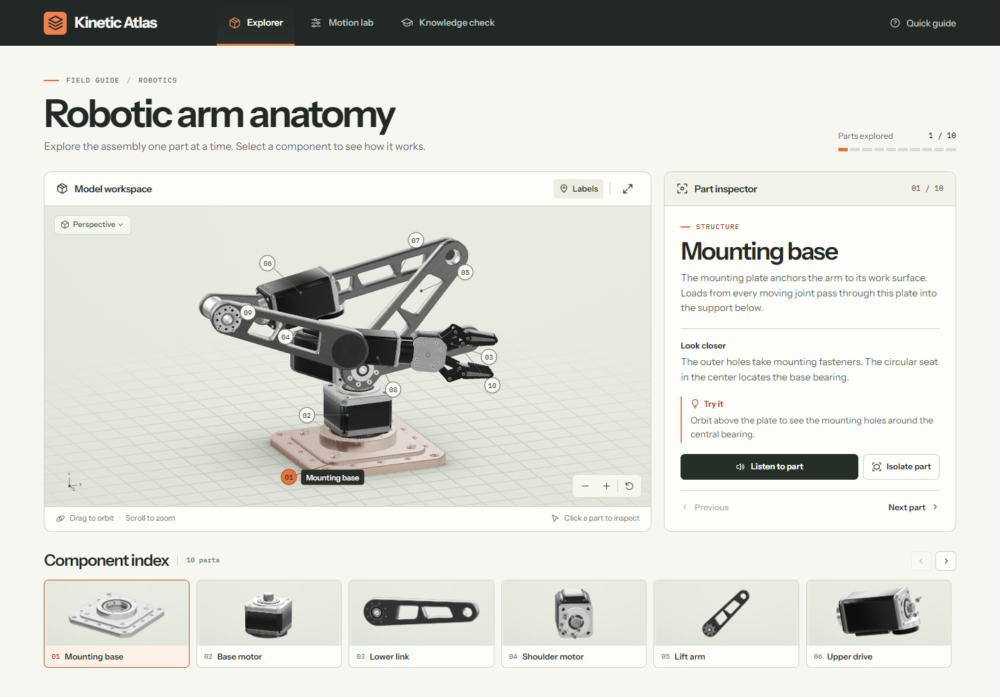

# Kinetic Atlas · Robotic arm anatomy

Explore a robotic arm built in Three.js. Select a component to hear its role, then move a joint to see how it affects the rest of the mechanism.

Open `index.html` in a browser with the adjacent `assets` directory. The website runs offline, including its fonts, component images, and spoken explanations. Alternatively, run `npm start` and open the loopback address printed in the terminal.

- **Explorer** lets you rotate, pan, zoom, select and isolate ten components. Each part has an explanation, a close inspection detail, an activity, and a local narration recording. The component index also works with a keyboard.
- **Motion lab** provides six controls for base rotation, shoulder lift, elbow bend, wrist swivel, tool pitch, and jaw opening. Joint values are illustrative settings for the modeled mechanism.
- **Knowledge check** asks learners to identify five components on the model or from a list. It offers feedback and reports first-attempt results. Parts explored are remembered in browser storage when available.

Drag to orbit, right-drag to pan, and scroll or pinch to zoom. With the canvas focused, use the arrow keys to orbit, + and − to zoom, and Home to reset the camera. Browsers without WebGL show component illustrations and retain the narration and quiz.

The original 1080p, 30 fps assembly film is available as `robotic-arm.mp4` and in the site's Quick guide.

## Shot breakdown

| Time | What happens |
| --- | --- |
| 0–3 s | A close view of the machined plate and bearing gives way to the descending base motor and its mounting screws. |
| 3–9 s | The lower link, shoulder motor, diagonal lift arm, upper drive, and return link seat in sequence. The camera lowers toward the side of the mechanism. |
| 10–16 s | The wrist actuator, front link, gripper, and remaining screws complete the assembly. The jaws close slightly. |
| 16–20 s | The lift arm rises as the wrist swings toward the camera and the gripper cycles. |

The geometry, rig, camera path, and mechanical soundtrack were recreated for this project by studying the published footage. Part dimensions and joint travel were estimated visually. [Reference film by Hamido Teck](https://x.com/HamidoFx1/status/2122766884311601329)

## Editing

`src/lesson-content.json` contains the component descriptions and questions. `src/explorer.js` handles camera controls, model selection, callouts, and articulation. `src/lesson.js` runs the panels, narration, progress, and quiz. `src/arm.js` and `src/machining.js` define the mechanical geometry. `src/shot.js` supplies the original film timeline. Studio reflections use Poly Haven’s CC0 HDR panorama. [Studio Small 08](https://polyhaven.com/a/studio_small_08)

After editing, run `npm ci` and `npm run build` with Node.js 20 or later. The build bundles the scene, renderer, and studio panorama into `assets/assembly.js`. Use `npm start` to serve the player on loopback if desired.

The narration is generated with the Piper US English Lessac medium voice. To regenerate it after a text change, install `piper-tts`, place the voice model and its companion JSON together, then run `python tools/narrate.py path/to/voice.onnx`. To refresh thumbnails after rebuilding the model, set `CHROME_PATH` and run `node tools/illustrate.mjs`. Font licenses are bundled in `assets/fonts`. [Piper voice model card](https://huggingface.co/rhasspy/piper-voices/blob/main/en/en_US/lessac/medium/MODEL_CARD)

To regenerate the film, set `CHROME_PATH` to a Chromium or Chrome executable and `FFMPEG_PATH` to an FFmpeg executable with H.264 and AAC support. Run `python tools/sound.py` followed by `node tools/render.mjs`. The renderer evaluates each frame on a fixed timeline and averages three shutter samples for motion blur.
